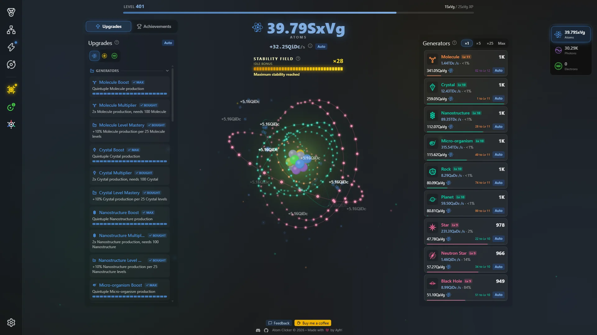
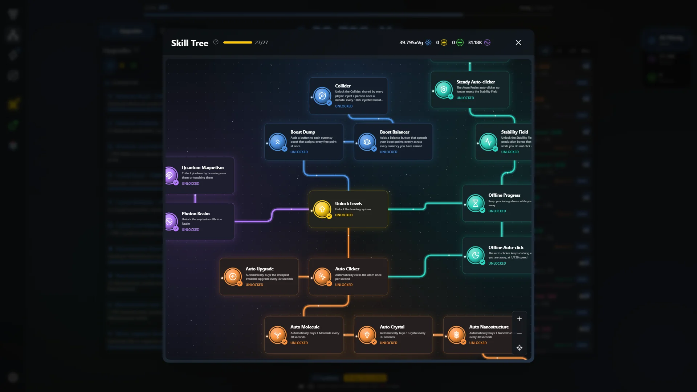
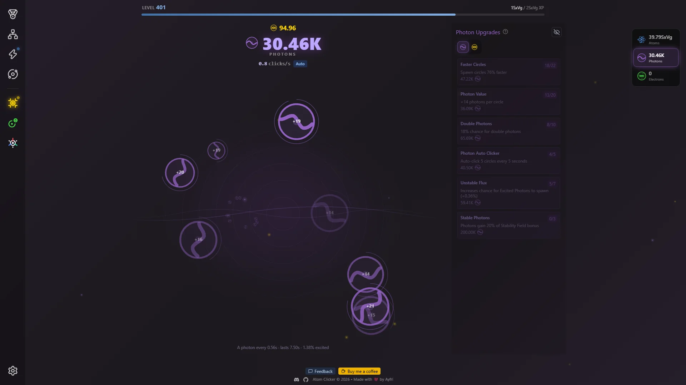

# ⚛️ Atom Clicker

Atom Clicker is an incremental game where you start by clicking a single atom and end up running an empire that spans several realms. It runs in your browser, saves your progress, works on phones and installs like a regular app.

[](https://github.com/Ayfri/Atom-Clicker)
[](https://discord.ayfri.com)
[](https://atom-clicker.ayfri.com)

🎮 [Play Now](https://atom-clicker.ayfri.com) | 💬 [Discord](https://discord.ayfri.com)





## 🎮 How to Play

1. **Click the Atom:** Tap the central atom to earn your first atoms.
2. **Buy Generators:** Spend atoms on generators that produce more atoms for you, even while you are away.
3. **Buy Upgrades:** Boost your clicks, your generators and everything in between.
4. **Grow the Skill Tree:** Skills unlock new mechanics and automation, and they stay through every prestige.
5. **Prestige:** When progress slows down, reset for Protons, Electrons and more, and come back stronger.
6. **Open new realms:** Each prestige step reveals a new place to play, with its own currency and its own way of boosting the others.
7. **Keep going:** Something deeper opens after your first Ionize. Go and find it.

New players get small tips that point at what to do next, and the interface opens up panel by panel as you unlock things.

## ⚛️ Features

### Three realms
- ⚛️ **Atom Realm:** the home of clicking, generators and upgrades, with an animated atom that grows and changes color as you progress.
- 🟣 **Photon Realm:** catch glowing circles to collect Photons and rare **Excited Photons** for exotic upgrades.
- ☢️ **Radiation Realm:** run a nuclear reactor, balance its mass, control rods and CPM, and turn the output into a production multiplier for every realm.

### Prestige layers
- **Protonize:** the first reset, earns Protons.
- **Electronize:** a deeper reset, earns Electrons.
- **Ionize:** the deepest reset, unlocked by running your reactor hot, with a Prism that sends colored light back into the Photon Realm.
- Each reset screen shows what you gain and what you keep, and some upgrades let your generators survive a reset.

### Progression
- 🏭 **Generators:** from tiny molecules to huge cosmic structures, each one levels up as you own more of it.
- ⬆️ **Upgrades:** each upgrade is one row that levels up along a bar, with a Buy All button and a toggle for bought ones.
- 🌳 **Skill Tree:** an animated tree where each skill unlocks a mechanic or an automation.
- 🔥 **Overdrive:** spend Higgs Bosons to double a generator's output.
- ⚡ **Power-ups and Higgs Bosons:** random power-ups appear while you play and stack, and Higgs Bosons give permanent bonuses.
- 🤖 **Automation:** auto-buy generators and upgrades, auto-click, and offline progress with a Welcome Back screen.
- 🏆 **Achievements:** grouped by theme, with claimable rewards.
- 🌌 **Late game:** a whole new layer opens once you Ionize. No spoilers here.

### Quarks and cosmetics
- ✨ **Quarks** are a rare currency earned from achievements and rotating **Daily Quests**.
- 🛒 **Quark Shop:** refundable boosts, convenience upgrades, realm themes and collectible leaderboard banners.

### Online features
- 📊 **Leaderboard:** a podium, search, a "near me" view and player profiles. Scores are verified on the server.
- ☁️ **Cloud saves:** sign in with Google, Discord or X to keep your progress across devices. Playing without an account works too, your save stays in your browser.
- 🌐 **Collider:** a particle ring shared by every signed-in player that boosts everyone's production.
- 📲 **Installable app:** install the game from your browser or home screen (a PWA), play offline, and get +10% production while you play from the installed app.
- 📱 **Mobile support:** a bottom bar, multi-finger tapping and a landscape layout.

## 🚀 Getting Started

You need [Bun](https://bun.sh/) and, to run the backend locally, [Docker](https://www.docker.com/).

1. Install dependencies:
```bash
bun install
```

2. Create your environment file:
```bash
cp .env.example .env
```
Fill in the three Supabase variables, either from your own Supabase project or from the local stack below:
- `PUBLIC_SUPABASE_URL`
- `PUBLIC_SUPABASE_PUBLISHABLE_KEY`
- `SUPABASE_SECRET_KEY`

`PUBLIC_GOOGLE_CLIENT_ID` is optional and only enables the Google One Tap prompt.

3. Start the development server:
```bash
bun dev
```

### 🗄️ Local Supabase

The backend can run entirely on your machine. The local stack only starts Postgres, PostgREST, Auth and Studio, everything else is disabled in `supabase/config.toml`.

```bash
bun db:start    # start the local stack, prints the API URL and keys
bun db:status   # show URLs and keys again
bun db:reset    # recreate the database from supabase/migrations + seed.sql
bun db:diff     # show the schema changes not yet in a migration
bun db:types    # regenerate src/lib/types/supabase.ts from the local schema
bun db:stop     # stop the containers
```

Point the three Supabase variables of your `.env` at the values printed by `bun db:start`. OAuth providers are off locally, create a test user from Studio (`http://127.0.0.1:54323`) instead. Schema changes go in `supabase/migrations/`.

### ✅ Checks

```bash
bun check   # svelte-kit sync + svelte-check, the type and Svelte correctness gate
bun test    # unit tests, *.test.ts files next to the code they cover
```

## 🛠️ Built With

- **Framework:** [SvelteKit](https://svelte.dev/docs/kit) with [Svelte 5](https://svelte.dev/) (runes)
- **Language:** [TypeScript](https://www.typescriptlang.org/)
- **Styling:** [Tailwind CSS 4](https://tailwindcss.com/)
- **Runtime and tooling:** [Bun](https://bun.sh/) and [Vite](https://vite.dev/)
- **Graphics:** hand-written HTML5 Canvas 2D for fast visuals, [Three.js](https://threejs.org/) for the 3D scenes
- **Backend, auth and cloud saves:** [Supabase](https://supabase.com/)
- **Hosting:** [Cloudflare Workers](https://workers.cloudflare.com/)
- **Icons:** [Lucide](https://lucide.dev)
- **Long lists:** [Virtua](https://github.com/inokawa/virtua)

## 🗂️ Project Layout

```
src/routes/               pages and API endpoints (+server.ts files under api/)
src/lib/components/       Svelte components, one folder per area (game, prestige, modals...)
src/lib/helpers/          game logic, the managers that hold the game state
src/lib/data/             static game content: generators, upgrades, skills, achievements...
src/lib/server/           server-only code (Supabase client, score checks, rate limits)
src/lib/stores/           small shared client stores
supabase/migrations/      database schema, one SQL file per change
static/                   public assets and the player-facing changelog
```

Game state lives in a few singleton manager classes built on Svelte 5 runes, mainly `GameManager` in `src/lib/helpers/GameManager.svelte.ts`. Imports use the aliases from `package.json` (`#components/*`, `#data/*`, `#helpers/*`, `#lib/*`, `#stores/*`).

## 🌐 Deployment

The game deploys to [Cloudflare Workers](https://workers.cloudflare.com/) through `@sveltejs/adapter-cloudflare`, configured by `wrangler.toml`.

```bash
bun run build
```

The build output goes to `.svelte-kit/cloudflare`, ready to be deployed with [Wrangler](https://developers.cloudflare.com/workers/wrangler/). Set the three Supabase variables as build and runtime variables on your Cloudflare project.

## 📝 License
This project is open source and available under the [GNU GPLv3 License](LICENSE).

## 🤝 Contributing
Contributions, issues, and feature requests are welcome! Feel free to check the [issues page](https://github.com/Ayfri/Atom-Clicker/issues). Before opening a pull request, run `bun check` and `bun test`.
